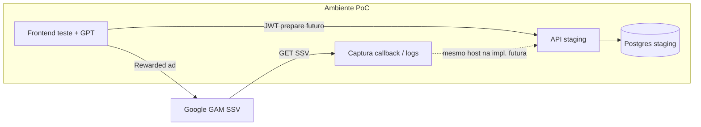

# Plano de PoC controlada — GAM Rewarded Web + SSV (RuneCodex)

**Data:** 2026-11-13  
**Escopo:** planejamento e validação de contrato — **sem implementação de integração.**  
**Documentos relacionados:**

- Spike original: [gam-rewarded-web-ssv-spike.md](./gam-rewarded-web-ssv-spike.md)
- Perguntas ao Google: [gam-google-support-questions.md](./gam-google-support-questions.md)

---

## 1. Objetivo da PoC

Reduzir incerteza técnica e risco de fraude antes de qualquer código de produção. A PoC deve **comprovar ou refutar**:

1. Existência e formato do callback SSV **real** para GAM Rewarded Web.
2. Mecanismo de autenticação (preferencialmente ECDSA) e reprodução da verificação no backend.
3. Mecanismo **oficial** de correlação entre sessão criada no backend e callback — **sem confiar** em `rewardedSlotGranted` ou em parâmetros não assinados.
4. Comportamento de replay, duplicata, atraso e erros de endpoint.
5. Compatibilidade com Web/PWA em `https://tritech.app.br/runescodex`.

**Fora de escopo:** conceder pontos em produção, alterar `RewardsService`, publicar frontend com GPT em produção, migrar schema.

---

## 2. Frente A — Contrato SSV (síntese da validação documental)

### 2.1 O que a documentação **confirma** (Web)

| Item | Evidência | Consulta |
|------|-----------|----------|
| Rewarded Web via GPT `OutOfPageFormat.REWARDED` | Help + sample GPT | 2026-11-13 |
| Eventos JS: `rewardedSlotReady`, `rewardedSlotGranted`, `rewardedSlotClosed` | 9116812, display-rewarded-ad | 2026-11-13 |
| SSV: se URL configurada na unidade, Google envia **GET** ao concluir interação | [9116812](https://support.google.com/admanager/answer/9116812) | 2026-11-13 |
| Recurso anunciado: SSV para rewarded **web inventory** | [179039](https://support.google.com/admanager/answer/179039) | 2026-11-13 |

### 2.2 O que **não** está documentado para Web (tratar como NÃO CONFIRMADO)

| Item | Notas |
|------|--------|
| Lista completa de query parameters do callback | Mobile doc é **comparação**, não prova |
| `signature`, `key_id`, algoritmo, `verifier-keys.json` no fluxo Web | Provável paridade com mobile; **não comprovado** |
| Configuração exata da URL SSV no painel GAM (rewarded **web**) | Sem acesso à conta neste trabalho |
| `custom_data` / binding de sessão a partir do GPT | **Gap crítico** |
| Política de retry/timeout do Google para Web SSV | Inferir do mobile até captura real |
| Inventário / ad unit de **teste** Web + SSV | **NÃO CONFIRMADO** |

### 2.3 Tabela comparativa do callback (planejamento)

| Campo | AdMob mobile SSV (doc) | GAM Rewarded Web | Status Web |
|-------|------------------------|------------------|------------|
| HTTP GET | Sim | Sim (9116812) | **Confirmado** |
| `transaction_id` | Sim | — | **NÃO CONFIRMADO** |
| `signature` / `key_id` | ECDSA | — | **NÃO CONFIRMADO** |
| `custom_data` | SDK `setCustomData` | — | **NÃO CONFIRMADO** |
| `user_id` | Opcional SDK | — | **NÃO CONFIRMADO** |
| Conteúdo assinado = query antes de `&signature=` | Sim (mobile) | — | **NÃO CONFIRMADO** |

### 2.4 Questão principal — vínculo da sessão

Respostas planejadas (preencher na PoC):

| Pergunta | Resposta esperada se aprovado | Status atual |
|----------|------------------------------|--------------|
| Identificador enviado pelo GPT? | API oficial documentada | **NÃO CONFIRMADO** |
| Parâmetro customizado aceito? | Ex.: `custom_data` no SSV | **NÃO CONFIRMADO** |
| Identificador retorna no callback? | Valor igual ao da sessão | **NÃO CONFIRMADO** |
| Protegido na assinatura? | Inclusão no payload ECDSA | **NÃO CONFIRMADO** |
| Usuário altera no navegador? | Alteração invalida crédito | Depende de assinatura |
| Backend identifica usuário sem JS? | Via sessão em campo assinado | **NÃO CONFIRMADO** |

---

## 3. Frente B — Ambiente da PoC

### 3.1 O que existe no repositório (inspeção somente leitura)

| Recurso | Estado |
|---------|--------|
| API produção (Render) | `render.yaml` → `runescodex-api`, `APP_ENV=production` |
| Blueprint staging | `render.staging.yaml` → serviço `runescodex-api-staging` (**não aplicado automaticamente**) |
| Guia de ambientes | `apps/api/ENVIRONMENTS.md` — `JWT_SECRET`, `DATABASE_URL`, `STAGING_DATABASE_HOST` / `PRODUCTION_DATABASE_HOST` |
| Local staging | `.env.staging.example`, `npm run start:staging` |
| Banco dev | `docker compose` + Postgres local |
| AdMob SSV (mobile) | `GET /ads/admob/ssv` público, verifier ECDSA em `admob-ssv.verifier.ts` |
| Web PWA | `https://tritech.app.br/runescodex`, base `/runescodex/` |
| GAM / GPT em produção | **Ausente** |

### 3.2 O que precisaria ser criado (sem executar nesta fase)

| Componente | Proposta |
|------------|----------|
| **API staging dedicada** | Aplicar `render.staging.yaml` no Render OU segundo serviço manual; `APP_ENV=staging`, CORS para origem de teste apenas |
| **Neon PostgreSQL staging** | Projeto/branch separado; nunca mesmo host que produção (`database-target` já recusa mistura) |
| **Frontend de teste isolado** | Subpath temporário ou Vite preview em host separado; **não** alterar `RewardsPage` prod até aprovação |
| **Endpoint público SSV** | URL estável HTTPS para PoC: preferir rota futura `GET /ads/gam/rewarded/ssv` no **staging**; alternativa fase 1: webhook.site / RequestBin só para **captura**, sem gravar rewards |
| **Logs PoC** | Canal dedicado: `poc_gam_ssv` com request id, transaction_id mascarado, resultado verify, **sem** JWT/query completa em produção de logs |
| **Secrets** | Nenhuma credencial GAM no frontend; JWT staging separado |
| **Conta GAM** | Inventário rewarded web, line item, fill, URL SSV apontando para staging ou capturador |
| **Domínio** | Autorizar `tritech.app.br` (e host de teste se diferente) no inventário |

### 3.3 Diagrama lógico da PoC

---

## 4. Endpoints planejados (contratos — não implementar neste trabalho)

### 4.1 `POST /ads/gam/rewarded/prepare`

**Autenticação:** `JwtAuthGuard`, `PremiumGuard` (espelhar `POST /ads/admob/rewarded/prepare`).

**Corpo (proposta):** opcional `{ "adUnitHint": "..." }` — inventário fixo por env na PoC.

**Comportamento planejado:**

1. Rate limit por usuário (ex.: 20 sessões / hora — alinhar a constantes AdMob existentes).
2. Criar sessão UUID, `userId`, `status=pending`, `expiresAt` (ex.: 10 min).
3. Persistir `provider=GAM_WEB` (conceitual; ver seção 5).
4. Retornar `{ sessionId, expiresAt, gamNetworkCode?, adUnitPath?, ... }` — **nunca** segredos de verificação.

**Respostas de erro:** 401, 403 premium, 429 rate limit.

### 4.2 `GET /ads/gam/rewarded/ssv`

**Autenticação:** nenhuma (callback Google); proteção = assinatura + allowlist IP opcional (se Google publicar faixas — **NÃO CONFIRMADO**).

**Comportamento planejado:**

1. Log sanitizado da query string.
2. Rejeitar se faltar `signature` / `transaction_id` (nomes exatos a confirmar na PoC).
3. Verificar ECDSA com chaves em `verifier-keys.json` **se** formato confirmado (reutilizar `admob-ssv.verifier.ts` após teste).
4. Resolver sessão via campo assinado (ex.: `custom_data` = `sessionId`).
5. Validar `expiresAt`, `userId`, estado `pending`, não `consumed`.
6. Inserir transação com PK `transaction_id`; em conflito → 200 idempotente sem novo crédito.
7. Atualizar sessão `consumedAt`, chamar `RewardsService.recordEvent(WATCH_AD, transaction_id)` **somente** se tudo válido.
8. Fail closed em qualquer falha de verificação ou chave desconhecida.

**Respostas:** 200 em sucesso ou duplicata benigna; 400 em assinatura inválida; 404/410 se sessão inválida (política exata a documentar após PoC).

### 4.3 `GET /ads/gam/rewarded/sessions/:id`

**Autenticação:** JWT.

**Comportamento:** retornar status da sessão **somente** se `session.userId === req.user.id`; nunca creditar por este endpoint.

**Campos de resposta (proposta):** `id`, `status`, `expiresAt`, `consumedAt`, `verificationStatus`, `failureReason?`.

---

## 5. Modelo de sessão proposto

### 5.1 Campos conceituais

| Campo | Descrição |
|-------|-----------|
| `id` | UUID v4 servidor |
| `userId` | Dono da sessão |
| `provider` | `GAM_WEB` (enum futuro) |
| `status` | `pending` \| `consumed` \| `expired` \| `failed` |
| `createdAt` / `expiresAt` / `consumedAt` | TTL e consumo |
| `externalTransactionId` | Preenchido após SSV (`transaction_id`) |
| `verificationStatus` | `unverified` \| `verified` \| `rejected` |
| `failureReason` | Código interno (ex.: `SIGNATURE_INVALID`) |

### 5.2 Reutilizar modelos AdMob?

| Opção | Prós | Contras |
|-------|------|---------|
| **A — Reusar `AdMobRewardSession` / `AdMobSsvTransaction`** | Já migrados; fluxo idêntico ao mobile; menos schema churn | Nome engana (GAM ≠ AdMob); `adUnitId` semântica GAM |
| **B — Novos modelos genéricos `RewardedAdSession` / `RewardedAdSsvTransaction`** | Provider-agnostic; prepara AppLixir | Migration futura; duplicação temporária |

**Recomendação de planejamento:** na PoC, usar **mesmas tabelas** se GAM confirmar paridade de callback com AdMob; se provider divergir (AppLixir), introduzir abstração **B** numa fase posterior. **Nenhuma alteração de schema neste trabalho.**

Estado atual no Prisma (`AdMobRewardSession`): `id`, `userId`, `expiresAt`, `consumedAt`, `transactionId?` — **não** há `provider` nem `status` explícito; status inferido por timestamps.

---

## 6. Matriz de cenários de segurança (obrigatória na PoC)

Legenda: **SIM** = payload fabricado para teste (nunca apresentar como callback real do Google).

### Cenário 1 — Callback legítimo

| Etapa | Detalhe |
|-------|---------|
| Preparação | Sessão `pending` + usuário U; exibir anúncio até conclusão |
| Requisição | GET real do Google com assinatura válida |
| Validações | ECDSA OK; `transaction_id` novo; sessão encontrada |
| HTTP | 200 |
| Banco | SSV row + `consumedAt`; `RewardEventReceipt` se meta atingida |
| Carteira | Crédito **somente** se missão concluir |
| Evidência | Log redigido + hash da query |

### Cenário 2 — Callback falso

| Preparação | Sessão válida |
| Requisição | GET manual imitando Google **SIM** |
| Validações | Falha assinatura ou allowlist |
| HTTP | 400 |
| Banco | Sem transação SSV; sessão `pending` ou `failed` |
| Carteira | Sem alteração |

### Cenário 3 — Assinatura inválida

| Requisição | Callback real ou **SIM** com `signature` alterada |
| Resultado | Rejeição; sem crédito |

### Cenário 4 — Transação repetida

| Preparação | Cenário 1 já processado |
| Requisição | Reenviar **mesmo** GET |
| HTTP | 200 (idempotente) |
| Banco | Uma linha SSV; sem segundo `recordEvent` |

### Cenário 5 — Sessão inexistente

| Requisição | `custom_data` / sessão UUID inexistente **SIM** ou real sem prepare |
| Resultado | Rejeição; sem crédito |

### Cenário 6 — Sessão expirada

| Preparação | `expiresAt` no passado |
| Resultado | Rejeição; política documentada (sem crédito automático) |

### Cenário 7 — Sessão de outro usuário

| Preparação | JWT de B consultando `sessions/:id` de A |
| HTTP | 403 ou 404 (não vazar existência) |

### Cenário 8 — Identificador adulterado

| Preparação | Atacante troca `sessionId` no JS antes do show |
| Requisição | SSV deve carregar apenas valor **Google-assinado** |
| Resultado | Sem associação indevida se assinatura não cobre valor adulterado |

### Cenário 9 — Callback atrasado

| Preparação | Simular entrega horas depois (replay Google ou proxy) |
| Resultado | Idempotência por `transaction_id`; expirar sessão se política exigir |

### Cenário 10 — Callback sem assinatura

| Requisição | Omitir `signature` **SIM** |
| Resultado | Fail closed |

### Cenário 11 — Chave pública desconhecida

| Requisição | `key_id` inexistente em `verifier-keys.json` |
| Resultado | Rejeição; não inventar chave |

### Cenário 12 — Indisponibilidade Google (chaves)

| Preparação | Mock falha ao buscar `verifier-keys.json` |
| Resultado | Fail closed; sem pontos |

### Cenário 13 — Concorrência

| Preparação | Dois workers processam mesmo `transaction_id` |
| Resultado | Unique PK + transação DB → um crédito |

### Cenário 14 — Sem correspondência

| Preparação | Callback válido Google mas sessão nunca criada |
| Resultado | Não conceder recompensa; log para investigação |

---

## 7. Requisitos de segurança e arquitetura

1. **Fail closed** — qualquer dúvida rejeita crédito.
2. **TLS** — endpoint SSV apenas HTTPS público.
3. **Segredos** — JWT, DB, AppLixir secret fora do bundle web.
4. **Validação server-side** — única fonte de verdade para crédito `WATCH_AD`.
5. **`transaction_id` único** — PK ou unique constraint.
6. **Sessão ↔ `userId`** — somente via campo confiável (assinado ou servidor).
7. **Expiração** — TTL curto na sessão.
8. **Replay** — dedupe por `transaction_id`.
9. **Transação atômica** — padrão `admob-rewarded.service.ts`.
10. **Logs** — mascarar tokens, não logar query completa com PII em prod.
11. **Rate limiting** — prepare + SSV (anti-abuso).
12. **Observabilidade** — métricas: verify_ok, verify_fail, duplicate, session_miss.
13. **`rewardedSlotGranted`** — **nunca** chama `recordEvent`.
14. **WATCH_AD** — apenas após SSV verificado.

---

## 8. Procedimento de teste real do callback (quando houver conta GAM)

1. Criar unidade **Rewarded Web** de teste no GAM.
2. Configurar line item / creatives com fill mínimo.
3. Configurar URL SSV → staging `GET /ads/gam/rewarded/ssv` ou capturador temporário.
4. Executar “Verify URL” se disponível no painel (**NÃO CONFIRMADO** para web).
5. Deploy apenas **staging** (não produção).
6. Autenticar usuário de teste; chamar prepare (quando implementado).
7. Carregar página PoC com GPT + `sessionId` binding (mecanismo TBD).
8. `makeRewardedVisible()` após opt-in; concluir anúncio.
9. **Capturar** query string completa (arquivo local, acesso restrito).
10. Documentar cada parâmetro; classificar Web vs suposição mobile.
11. Rodar verifier existente contra payload — registrar pass/fail.
12. Verificar se identificador de sessão aparece e está na parte assinada.
13. Reenviar callback (replay).
14. Alterar um caractere da assinatura — confirmar rejeição.
15. Arquivar evidências com credenciais e user ids **mascarados**.

**Não inventar payloads** como capturas reais. Exemplos hipotéticos rotular **SIMULAÇÃO**.

---

## 9. Critérios de aprovação (matriz)

Estados: **APROVADO** | **REPROVADO** | **NÃO CONFIRMADO**.

| # | Critério crítico | Estado inicial |
|---|------------------|----------------|
| 1 | Callback SSV real para GAM Rewarded Web | Parcialmente confirmado (doc); **APROVADO** só após captura |
| 2 | Mecanismo confiável de autenticação | **NÃO CONFIRMADO** (web) |
| 3 | Backend verifica autenticidade | **NÃO CONFIRMADO** (depende de 2) |
| 4 | Correlação segura sessão ↔ callback | **NÃO CONFIRMADO** |
| 5 | Correlação sem confiar em JS | **NÃO CONFIRMADO** |
| 6 | Usuário identificado por dados confiáveis | **NÃO CONFIRMADO** |
| 7 | Proteção replay | Parcial (se `transaction_id`) |
| 8 | Idempotência | Desenho pronto; **NÃO CONFIRMADO** em GAM web |
| 9 | Callback falso não gera recompensa | Desenho fail closed |
| 10 | Compatível Web/PWA | Parcial (GPT); PoC em PWA obrigatória |

**Regra:** qualquer item crítico **NÃO CONFIRMADO** após PoC + Google → integração GAM **BLOQUEADA**.

---

## 10. Comparação GAM vs AppLixir (PoC)

| Propriedade | GAM Rewarded Web | AppLixir |
|-------------|------------------|---------|
| Transporte callback | GET servidor Google | GET servidor AppLixir |
| Integridade | ECDSA (se confirmado web) | MD5(secret) — **não** equivalente a assinatura assimétrica |
| Identificador transação | `transaction_id` (se confirmado) | `tid` na query |
| Sessão backend | `custom_data` (se confirmado) | `userId` no hash; `customData` **não** assinado |
| Adulteração pelo cliente | Mitigada se campo na assinatura | `userId` passado pelo player — token opaco de sessão recomendado |
| Replay | Dedupe `transaction_id` | Dedupe `tid` |
| Terceiro | Google (inventário próprio) | AppLixir + políticas |
| Complexidade | Alta (GAM + GPT + SSV) | Média |

**AppLixir:** MD5 com segredo compartilhado prova que quem conhece o secret montou a URL — **não** prova que o Google entregou o anúncio sem fraude interna do terceiro. Para RuneCodex, `userId` = token opaco da sessão server-side cobre **binding usuário** se `userId` entrar no MD5; **não** cobre binding arbitrário via `customData`.

---

## 11. O que pode ser feito sem conta GAM

- Finalizar documentação e perguntas ao Google ([gam-google-support-questions.md](./gam-google-support-questions.md)).
- Provisionar staging API + DB (infra separada).
- Página HTML **isolada** com GPT em ad unit de demonstração **sem** SSV (só UX) — opcional e fora do repo prod.
- Testes **SIM** dos cenários 2, 3, 5, 6, 7, 10–13 contra handler mock.
- Revisar unitários do `admob-ssv.verifier.ts` com vetores **SIMULAÇÃO** do doc mobile.

---

## 12. Dependências

| Dependência | Bloqueia |
|-------------|----------|
| Conta GAM + inventário rewarded web | Captura callback real |
| Resposta oficial Google sobre `custom_data` GPT | Aprovação critérios 4–6 |
| Staging HTTPS público | Configurar URL SSV |
| Implementação futura (pós-aprovação) | Endpoints, migrations se necessário |

---

## 13. Confirmação de escopo deste documento

Este plano **não** implementou integração GAM, endpoints, frontend, migrations, deploy ou contato com Google. Apenas documentação.
