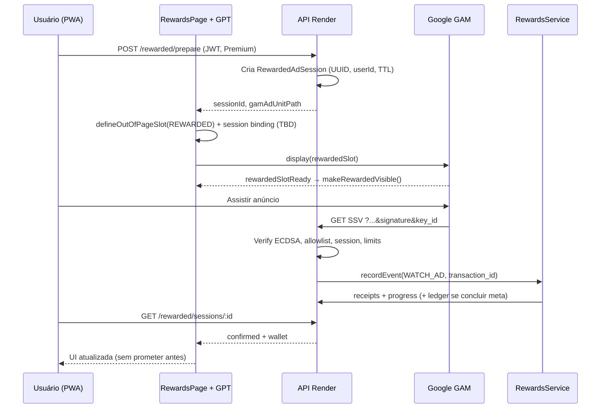

# Spike técnico — GAM Rewarded Web + SSV (RuneCodex)

**Data:** 2026-03-29  
**Escopo:** investigação somente leitura. Nenhuma alteração de código, banco, migration, deploy ou configuração externa.  
**Produto:** Web/PWA em `https://tritech.app.br/runescodex` (base `/runescodex/`).  
**API default no cliente web:** `https://runescodex-api.onrender.com` (`apps/web/src/services/api/client.ts`).

---

## 1. Resumo executivo

O Google Ad Manager (GAM) documenta **rewarded ads para Web** via **Google Publisher Tag (GPT)** e, desde a atualização de inventário descrita no release notes (out/2025–out/2026), **server-side verification (SSV) para rewarded web**, com callbacks **GET** disparados pelos servidores do Google quando o usuário conclui a interação recompensada.

**Porém**, a documentação **oficial de GPT/Web** descreve apenas eventos JavaScript no navegador (`rewardedSlotReady`, `rewardedSlotGranted`, `rewardedSlotClosed`) e **não documenta** como enviar `custom_data` ou equivalente a partir do GPT para correlacionar o callback SSV com uma **sessão criada no backend RuneCodex**.

A validação criptográfica de callbacks SSV (`signature`, `key_id`, `transaction_id`, chaves em `gstatic.com/admob/reward/verifier-keys.json`) está **bem documentada para SDKs mobile/AdMob**, não em página dedicada **“GAM Rewarded Web SSV”** com parâmetros e exemplos.

**Conclusão preliminar do spike:** GAM Rewarded Web + SSV é **parcialmente confirmado** como direção viável, mas **não está aprovado para implementação** até validação empírica em conta GAM real: (a) callback recebido com assinatura verificável; (b) mecanismo oficial de transporte do identificador de sessão (ex.: `custom_data`) **a partir do GPT Web**.

**AppLixir** oferece webhook GET com MD5+`tid` e encaixa melhor no Web/PWA do ponto de vista de API HTML5, com modelo de segurança **mais simples e mais fraco** que ECDSA do Google.

**Recomendação final (spike):** **não implementar ainda** em produção. Próximo passo obrigatório: **PoC GAM** com captura de callback (ex.: webhook.site) + confirmação com suporte Google/account manager sobre binding sessão no GPT Web; em paralelo, manter **AppLixir** como plano B se GAM não permitir correlacionar sessão↔usuário sem confiar no navegador.

---

## 2. Contexto da arquitetura atual (código inspecionado)

### 2.1 Rewards (reutilizável)

| Componente | Localização | Papel |
|------------|-------------|--------|
| `RewardsService.recordEvent` | `apps/api/src/rewards/rewards.service.ts` | Único motor de progresso; exige `referenceId` |
| `WATCH_AD` | `apps/api/src/rewards/rewards.constants.ts` | Evento suportado |
| `RewardEventReceipt` | Prisma | Idempotência por `(userId, eventType, referenceId, missionId, periodStart)` |
| `UserMissionProgress` | Prisma | Progresso por período UTC |
| `RewardWallet` / `RewardLedgerEntry` | Prisma + SQL CHECK ≥ 0 | Crédito na conclusão da missão |
| Missões anúncio | `apps/api/prisma/seed/rewards.ts` | Diária 3/30, semanal 5/70, mensal 15/250, `WATCH_AD` |
| Premium | `RewardsController`, rotas ads prepare/status | `JwtAuthGuard` + `PremiumGuard` |

**Chamadas a `recordEvent` (código):** fórum, community rotations, `AdMobRewardedService` — **sem** endpoint cliente para eventos.

### 2.2 AdMob mobile (não é Web)

| Peça | Localização |
|------|-------------|
| SSV verifier (ECDSA) | `apps/api/src/ads/admob-ssv.verifier.ts` |
| Serviço / controller | `admob-rewarded.service.ts`, `admob-rewarded.controller.ts` |
| Rotas | `POST /ads/admob/rewarded/prepare`, `GET /ads/admob/ssv`, `GET /ads/admob/rewarded/sessions/:id` |
| Modelos | `AdMobRewardSession`, `AdMobSsvTransaction` |
| Cliente | `apps/mobile/...` (`rewarded-ad.js`, `shop.js`) — **não** usado pelo PWA |

### 2.3 Web/PWA (estado atual)

| Item | Estado |
|------|--------|
| `apps/web/src/pages/RewardsPage.tsx` | Carteira, missões, conversão, resgate — **sem** anúncio |
| `apps/web/src/domain/rewards.ts` | `WATCH_AD` jogável; `missionActivityPath` → `/rewards` |
| `vite.config.ts` | `base: /runescodex/`, PWA Workbox |
| `index.html` | `viewport` mobile (relevante para elegibilidade GPT) |

---

## 3. Documentação oficial consultada

| # | Fonte | O que sustenta |
|---|--------|----------------|
| 1 | [Traffic rewarded ads for web (9116812)](https://support.google.com/admanager/answer/9116812) | GPT `OutOfPageFormat.REWARDED`; eventos `rewardedSlotReady/Granted/Closed`; `makeRewardedVisible()`; **SSV para web**: se URL configurada na unidade, Google envia **GET** ao endpoint quando o usuário completa a interação |
| 2 | [Display a rewarded ad (GPT sample)](https://developers.google.com/publisher-tag/samples/display-rewarded-ad) | Eventos `RewardedSlotGrantedEvent`, etc.; `defineOutOfPageSlot` pode retornar **null**; suporte focado em páginas **mobile-optimized** (viewport) |
| 3 | [GPT Reference – RewardedPayload](https://developers.google.com/publisher-tag/reference) | `payload.amount` / `payload.type` — metadado de recompensa do **anúncio**, não prova server-side |
| 4 | [What's new – SSV rewarded web (179039)](https://support.google.com/admanager/answer/179039) | Anúncio de recurso: validação SSV para **rewarded web inventory** no Ad Manager |
| 5 | [Validate SSV callbacks (AdMob/Android)](https://developers.google.com/admob/android/ssv) | Parâmetros do callback (`transaction_id`, `signature`, `key_id`, `custom_data`, ordem alfabética, conteúdo assinado antes de `&signature=`, verificação ECDSA, `verifier-keys.json`) — documentação **SDK/app**, referência para **formato** de callback se o web usar o mesmo |
| 6 | [Rewarded apps SSV setup (7386053)](https://support.google.com/admanager/answer/7386053) | SSV em unidades **app** via postback URL — não substitui doc web específica de parâmetros |
| 7 | [AppLixir Web callback Step 4](https://support.applixir.com/applixir-integration/integration-for-html5-sites-apps/step-4-setting-up-local-callback-360053188774) | Webhook GET, MD5+`tid`, `customData` **fora** da assinatura |

**Separação explícita:** documentação **GPT + 9116812** = Web. Documentação **setCustomData / ServerSideVerificationOptions** = **Mobile Ads SDK**, não GPT.

---

## 4. Funcionamento do GAM Rewarded Web

1. Publisher cria inventário rewarded web no Ad Manager e implementa GPT.
2. `googletag.defineOutOfPageSlot(adUnitPath, googletag.enums.OutOfPageFormat.REWARDED)`.
3. Ouve `rewardedSlotReady` → usuário opt-in → `makeRewardedVisible()`.
4. Google exibe fullscreen; recompensa concedida quando critérios de conclusão atendidos (vídeo completo, tempo de display ≥ 7s para grant, etc. — [9116812](https://support.google.com/admanager/answer/9116812)).
5. `rewardedSlotGranted` dispara no **navegador** (UX apenas para RuneCodex).
6. Se SSV configurado na unidade, Google envia **GET** ao servidor do publisher **em paralelo** ([9116812](https://support.google.com/admanager/answer/9116812)).

**Limitações documentadas:**

- Um rewarded visível por vez.
- `defineOutOfPageSlot` pode retornar `null` (página não elegível).
- Sample GPT enfatiza **mobile-optimized** pages ([display-rewarded-ad](https://developers.google.com/publisher-tag/samples/display-rewarded-ad)) — desktop/tablet mencionados no help 9116812, mas elegibilidade técnica **deve ser testada**.

---

## 5. Análise do vínculo sessão → usuário → callback

### 5.1 Preparação da sessão (fluxo desejado RuneCodex)

Fluxo alinhado ao AdMob mobile já existente:

1. `POST …/rewarded/prepare` (JWT + Premium).
2. Backend cria UUID, `userId`, TTL, status `pending`.
3. Frontend recebe `sessionId` + metadados GPT (ad unit path, etc.).

**GAM:** o passo 1–3 é **independente do provedor** e pode reutilizar `AdMobRewardSession` (ou nome genérico futuro).

### 5.2 Transporte do identificador de sessão

| Mecanismo | AdMob mobile SDK | GPT Web (oficial) | Status |
|-----------|------------------|-------------------|--------|
| `custom_data` no SSV | `ServerSideVerificationOptions.customData` antes do show ([Android SSV](https://developers.google.com/admob/android/ssv)) | **Não documentado** em GPT Reference / sample | **NÃO CONFIRMADO** |
| `user_id` no SSV | Opcional via SDK | **Não documentado** para GPT | **NÃO CONFIRMADO** |
| Key-value targeting GPT | `slot.setConfig({ targeting: … })` ([key-value targeting](https://developers.google.com/publisher-tag/guides/key-value-targeting)) | Targeting de line items; **não** documentado como eco em `custom_data` SSV | **NÃO CONFIRMADO** |

**Adulteração:** qualquer valor definido **apenas** via JavaScript no navegador **não é prova** de identidade. Só é aceitável se o **callback SSV assinado pelo Google** incluir o mesmo valor de forma **integrada ao conteúdo assinado** (como `custom_data` no modelo AdMob).

**Gap crítico:** sem documentação GPT de API equivalente a `setCustomData`, o vínculo **sessão RuneCodex ↔ callback Google** para Web é **NÃO CONFIRMADO**.

Hipóteses a validar em PoC (não especulação de implementação):

- SSV web usa o **mesmo** formato assinado e aceita `custom_data` se configurado por meio não documentado no painel GAM.
- Google documenta método GPT posterior ou tag key-values que entram no payload assinado.

### 5.3 Callback server-to-server (GAM)

**Confirmado (nível alto):**

- Método: **GET** ([9116812](https://support.google.com/admanager/answer/9116812)).
- Disparo: servidores Google ao completar interação rewarded web.
- URL: configurada na unidade rewarded no Ad Manager (detalhe de UI **NÃO CONFIRMADO** neste spike sem acesso à conta).

**NÃO CONFIRMADO para GAM Web especificamente (devem ser inferidos do doc mobile SSV até captura real):**

- Lista exata de query params.
- Presença de `signature` + `key_id` + `transaction_id`.
- Uso de `https://www.gstatic.com/admob/reward/verifier-keys.json`.

**Autenticação:** se o formato for o do [Android SSV](https://developers.google.com/admob/android/ssv), o backend **não** deve confiar em HTTPS ou formato plausível — deve validar **ECDSA** sobre a substring raw antes de `&signature=`.

**Requisições manuais:** sem assinatura válida, devem falhar — desde que verificação esteja implementada (RuneCodex já tem `admob-ssv.verifier.ts`).

### 5.4 Correlação e idempotência (proposta, não implementada)

Estratégia alinhada ao AdMob existente, aplicável se `custom_data` = `sessionId` no SSV:

| Regra | Mecanismo PostgreSQL |
|-------|----------------------|
| Sessão → um usuário | `AdMobRewardSession.userId` |
| Uma recompensa por sessão | `consumedAt` + unique `transactionId` na sessão |
| Uma transação externa uma vez | PK `AdMobSsvTransaction.transactionId` |
| Callback repetido | `duplicate` sem novo `recordEvent` |
| Sessão expirada | Rejeitar se `expiresAt < now()` |
| Sem sessão | Rejeitar se `custom_data` não encontrado |
| `WATCH_AD` idempotente | `RewardEventReceipt` + `referenceId = transaction_id` |

Tudo dentro de **uma transação Prisma** (padrão já usado em `admob-rewarded.service.ts`).

---

## 6. Análise de autenticação do callback

| Provedor | Mecanismo documentado | Adequação RuneCodex |
|----------|----------------------|---------------------|
| **GAM Web SSV** | Anti-fraude + GET callback ([9116812](https://support.google.com/admanager/answer/9116812)); detalhes criptográficos **NÃO CONFIRMADO** na doc web | Reutilizar `admob-ssv.verifier.ts` **se** PoC provar mesmo formato |
| **AdMob mobile SSV** | ECDSA, `key_id`, `verifier-keys.json` ([Android SSV](https://developers.google.com/admob/android/ssv)) | Implementado no repo |
| **AppLixir** | MD5(`gameApiKey+gameId+userId+tid+secret`) ([Step 4](https://support.applixir.com/.../step-4-...)) | Novo adaptador; `customData` **não** assinado |

**Eventos GPT** (`rewardedSlotGranted`, etc.): **não são autenticação** — apenas UI ([9116812](https://support.google.com/admanager/answer/9116812), [GPT sample](https://developers.google.com/publisher-tag/samples/display-rewarded-ad)).

---

## 7. Análise de idempotência e replay

- **Google (se `transaction_id` único):** replay = segundo GET com mesmo id → dedupe (padrão AdMob).
- **Google retries:** doc mobile recomenda tratar callbacks como podendo repetir; responder `200` em duplicata ([Android SSV](https://developers.google.com/admob/android/ssv) — boas práticas).
- **AppLixir:** at-least-once; dedupe em `tid` ([Step 4](https://support.applixir.com/.../step-4-...)).

---

## 8. Compatibilidade Web/PWA RuneCodex

| Aspecto | Avaliação |
|---------|-----------|
| React + Vite + `/runescodex/` | Compatível; carregar `gpt.js` async na rota Rewards |
| Viewport | `index.html` tem `width=device-width` — alinhado ao requisito GPT mobile-optimized |
| Desktop | Help 9116812 cita desktop; GPT sample enfatiza mobile — **testar** `defineOutOfPageSlot` em desktop |
| PWA instalada | Mesma origem `tritech.app.br`; **NÃO CONFIRMADO** comportamento rewarded em standalone iOS/Android |
| Workbox | `globPatterns` JS/CSS; **não** cachear `googletag` / `doubleclick`; `navigateFallbackDenylist` já exclui `/runescodex/api` — SSV é na API Render, não no SW |
| Ad blockers | Inventário indisponível → UI “anúncio indisponível” |
| `rewardedSlotRenderEnded` | Não listado no help 9116812 (usa `SlotRenderEndedEvent` na tabela); GPT Reference lista eventos — usar apenas para UX |

---

## 9. Requisitos operacionais Google Ad Manager

**NÃO assumido:** RuneCodex possui conta GAM, inventário rewarded, line items, fill ou aprovação.

**Documentado:**

- Conta Google Ad Manager com rewarded web traffic ([9116812](https://support.google.com/admanager/answer/9116812)).
- Unidade rewarded + line items (video 1x1v ou display 1x1 conforme tipo).
- Compliance com [policies for ad units that offer rewards](https://support.google.com/adsense/answer/9121589) (recompensa na plataforma, não dinheiro direto).
- Desativar proteção “Block non-instream video ads” ([9116812](https://support.google.com/admanager/answer/9116812)).
- Demanda/programática — sem fill, `rewardedSlotReady` não dispara.
- SSV URL na configuração da unidade — procedimento exato **NÃO CONFIRMADO** sem painel.

---

## 10. Comparação GAM vs AppLixir

| Dimensão | GAM Rewarded Web | AppLixir HTML5 |
|----------|------------------|----------------|
| Callback S2S | GET Google ([9116812](https://support.google.com/admanager/answer/9116812)) | GET AppLixir ([Step 4](https://support.applixir.com/.../step-4-...)) |
| Prova criptográfica | ECDSA documentada para SSV mobile; web **NÃO CONFIRMADO** | MD5 + secret |
| Sessão no callback | `custom_data` SDK; GPT **NÃO CONFIRMADO** | `userId` / `customData` no player; `customData` **fora** da assinatura |
| Web/PWA | Nativo GPT | Nativo HTML5 |
| Conta / onboarding | GAM (barreira alta) | Dashboard AppLixir |
| Política Google pontos internos | Mesmas políticas de rewarded | Terceiro + políticas próprias |

**AppLixir — binding seguro ao usuário RuneCodex:** documentação recomenda passar `userId` no player; para não expor ID interno, usar **token opaco de sessão** como `userId` no player e mapear no webhook — ainda **client-controlled** (usuário só pode fraudar a si se assistir anúncio real). Não confiar em `customData` para segurança ([Step 4](https://support.applixir.com/.../step-4-...)).

---

## 11. Arquitetura futura proposta (se SSV + sessão forem confirmados em PoC)

Se **binding GPT→SSV** não for confirmado, **não** usar este fluxo — considerar AppLixir ou adiar.

---

## 12. Riscos e limitações

1. **NÃO CONFIRMADO:** `custom_data` / sessão no SSV GAM Web.  
2. **NÃO CONFIRMADO:** parâmetros e assinatura idênticos ao AdMob mobile.  
3. Inventário vazio / conta GAM inexistente.  
4. GPT `null` em alguns ambientes (desktop, bloqueadores).  
5. Políticas Google sobre recompensas (pontos internos OK com disclosure).  
6. PWA + iOS Safari fullscreen/ITP.  
7. Migration AdMob no banco pode não estar aplicada em prod — **NÃO VERIFICADO**.

---

## 13. Conclusão objetiva (checklist §12)

| # | Pergunta | Resposta |
|---|----------|----------|
| 1 | GAM oferece SSV real ou só JS? | **SSV real documentado** ([9116812](https://support.google.com/admanager/answer/9116812)) **+** eventos JS para UX. |
| 2 | Como Google comprova callback? | **NÃO CONFIRMADO** para web; mobile doc indica **ECDSA** ([Android SSV](https://developers.google.com/admob/android/ssv)). |
| 3 | Como callback identifica sessão backend? | **NÃO CONFIRMADO** para GPT Web; mobile usa `custom_data` via SDK. |
| 4 | Como backend descobre usuário? | Desenho RuneCodex: **sessão no servidor** via `custom_data` — depende de (3). |
| 5 | Impedir falsos/repetidos? | Assinatura + `transaction_id` + PK (se formato AdMob); limites servidor. |
| 6 | Sem confiar no navegador? | **Só se SSV assinado + sessão no payload assinado** — **não comprovado** para GPT ainda. |
| 7 | GAM aprovado para implementação? | **Não** — aguardar PoC. |
| 8 | AppLixir mais adequado? | **Mais simples para Web**; segurança **inferior** a ECDSA; binding via `userId` opaco + MD5. |
| 9 | Recomendação | **PoC GAM obrigatório**; **não implementar** sem callback capturado; AppLixir como plano B. |

---

## 14. Matriz de decisão

| Critério | GAM Rewarded Web | AppLixir |
|----------|------------------|----------|
| Compatibilidade Web/PWA | **Confirmado** (GPT web) | **Confirmado** (HTML5) |
| Callback server-to-server | **Confirmado** (GET Google) | **Confirmado** (GET webhook) |
| Vínculo com sessão do backend | **Não confirmado** (GPT `custom_data`) | **Parcialmente confirmado** (`userId` assinado; `customData` não) |
| Autenticação do callback | **Parcialmente confirmado** (SSV existe; crypto web não documentada) | **Confirmado** (MD5+secret) |
| Proteção contra replay | **Parcialmente confirmado** (se `transaction_id` como mobile) | **Confirmado** (`tid`) |
| Idempotência | **Parcialmente confirmado** (padrão RuneCodex + `transaction_id`) | **Confirmado** (`tid`) |
| Complexidade | **Alta** (GAM + GPT + SSV) | **Média** |
| Dependência config. externa | **Alta** (conta GAM, fill, SSV URL) | **Média** (dashboard AppLixir) |
| Segurança geral | **Parcialmente confirmado** (potencial alto se ECDSA + sessão) | **Parcialmente confirmado** (MD5; não equivalente a ECDSA) |

---

## 15. Recomendação final e pendências

### Recomendação

1. **Não implementar** integração GAM em produção neste ciclo.  
2. Executar **PoC** com conta GAM de teste: rewarded web + SSV URL (webhook.site / staging API) + unidade de exemplo Google se disponível.  
3. Gravar **query string completa** do callback; testar `admob-ssv.verifier.ts` contra ela.  
4. Perguntar ao **suporte/account manager Google** como passar **session id** no GPT Web para aparecer em `custom_data` assinado no SSV.  
5. Se PoC falhar em (3–4): avaliar **AppLixir** com `userId` = token de sessão server-side e adaptador MD5.

### Pendências externas (dependem de você / Google)

- Criação ou acesso a **Google Ad Manager**.  
- Unidade **Rewarded Web** + line items + fill.  
- Configuração **SSV URL** → `https://runescodex-api.onrender.com/...` (path a definir na implementação futura).  
- Domínio `tritech.app.br` autorizado no inventário.  
- Validação jurídica/disclosure de recompensa por anúncio ([9121589](https://support.google.com/adsense/answer/9121589)).

### Confirmação de escopo do spike

Nenhum código de produção, schema Prisma, migration, seed, dependência, endpoint, frontend, backend, Render ou Google Ad Manager foi alterado durante este spike. Apenas este documento foi adicionado.

---

## 16. Atualização complementar (PoC + perguntas Google)

**Data:** 2026-11-13  
**Motivo:** encerrar Frente A/B do plano de validação de contrato sem alterar conclusões do spike.

### Documentos derivados

| Arquivo | Conteúdo |
|---------|----------|
| [gam-rewarded-web-poc-plan.md](./gam-rewarded-web-poc-plan.md) | Ambiente staging, endpoints **planejados**, modelo de sessão, 14 cenários de fraude, procedimento de captura, matriz de aprovação |
| [gam-google-support-questions.md](./gam-google-support-questions.md) | Perguntas PT/EN ao suporte GAM; checklist do que permanece NÃO CONFIRMADO |

### Frente A — registro adicional de consulta (2026-11-13)

Revisão das mesmas URLs da §3 com foco em **contrato de callback Web**. Nenhuma fonte oficial adicional encontrada que liste parâmetros SSV ou binding de sessão para GPT. Conclusões das §§5–13 **permanecem**.

### Frente B — status

PoC **planejada**, não executada. Implementação continua **bloqueada** até captura real + resposta Google sobre `custom_data` (ou equivalente) no fluxo Web.

### Confirmação de escopo (atualização)

Nenhum código, migration, endpoint, deploy ou configuração externa foi alterado na atualização de 2026-11-13. Apenas os documentos listados acima foram adicionados ou esta seção foi acrescentada.
